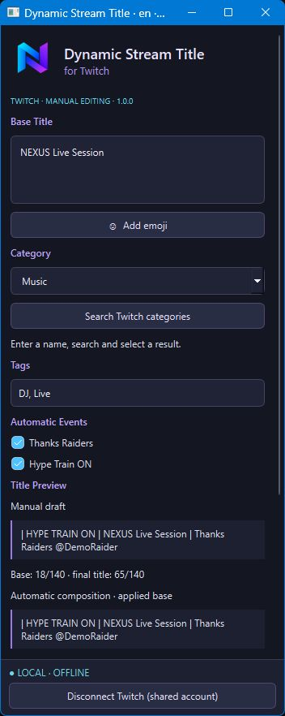
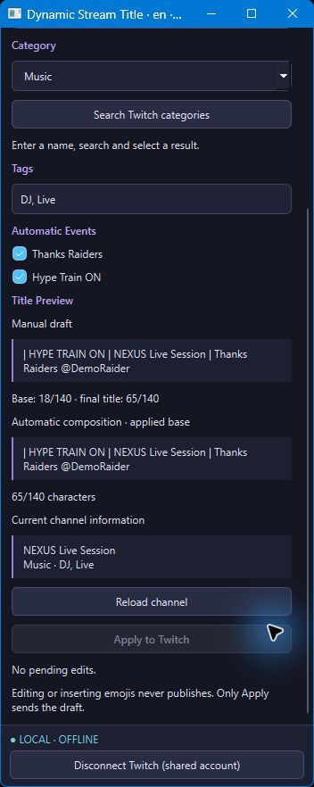

# Dynamic Stream Title for Twitch — NEXUS

An OBS Studio dock for managing Twitch stream titles, categories and tags, with optional raid and Hype Train automation. Developed for Windows x64 and OBS 32.x.

**Project version: 1.0.0.** The GitHub repository currently provides this overview and example images. Source code, installers and downloadable releases have not yet been uploaded here.

## Features

- **Manual title editor:** prepare a base title, category and tags, insert emojis and review the result before publishing.
- **Explicit publishing:** editing or inserting emojis does not publish. Only **Apply to Twitch** sends the manual draft.
- **Thanks Raiders:** optionally add raiding channels to the applied title without duplicating a channel after repeated raids.
- **Hype Train:** independently enable a Hype prefix that is added and removed as events arrive.
- **Applied-title automation:** automatic events use the last applied base, preserving pending title, category and tag edits.
- **Live-state checks:** each automatic send checks the Twitch broadcast state; offline events are ignored.
- **Conflict handling:** reload the current channel before publishing. External changes pause the affected operation with a warning; **Reload channel** reconciles the base while preserving the draft.
- **Session recovery:** drafts survive reconnects without being sent automatically. There are no silent periodic publication retries.
- **Five languages:** English, Spanish, Italian, French and German in the interface, installer and illustrated guide.
- **Shared Twitch connection:** uses Twitch Core 1.1.0, ABI 6, and can coexist with compatible NEXUS consumers without adding another EventSub connection or event polling.

## Preview

*Actual English UI in a local offline demonstration, with sample title and DemoRaider data. This is not evidence of a live Twitch event.*

*Preview and channel controls from the same demonstration. No pending edits: Apply is disabled.*

## How it works

1. Open the Dynamic Stream Title dock in OBS and connect Twitch. Complete sign-in and consent personally in the browser when requested.
2. Prepare the title, category and tags, then check the preview.
3. Click **Apply to Twitch** to establish the manual base.
4. Enable **Thanks Raiders** and/or **Hype Train ON** if desired. These options are independent.

Twitch does not provide an atomic read-and-update operation: an external edit or broadcast ending can occur between the check and the send. A restored Hype state is the last observation; disable that option if the train ended while OBS was closed.

## Installation and compatibility

The local 1.0.0 distribution includes the plugin, a Windows installer, Twitch Core and an illustrated guide. The installer is unsigned. Close OBS before installing; standard Program Files installation requests administrator permission.

Title requires Twitch Core >=1.1.0 and <2.0.0, ABI 6. The installer preserves newer compatible Core versions, checks consumers before updating and keeps Core when another consumer still needs it. Existing scenes, presets, configuration and credentials are preserved.

## Validation and limits

The local report records 30 suites, installer testing and OBS interface review. Recovery, repeated raids, Hype, conflicts and offline/live states were exercised using local services. These checks do not replace real raid/Hype events and extended live-stream testing for this revision.

Portable OBS reported one residual allocation on shutdown with both plugins, compared with zero in the reference run. Attribution remains under investigation; leak-free shutdown is not claimed. Global OBS resource use must not be attributed entirely to this plugin.

## License

Project code is declared **GPL-2.0-or-later**. See [LICENSE](LICENSE). Third-party components retain their own terms; their notices must accompany future source and binary distributions.

a plugin from [DjEmiMas](https://discord.gg/dhcqZPDYh)
